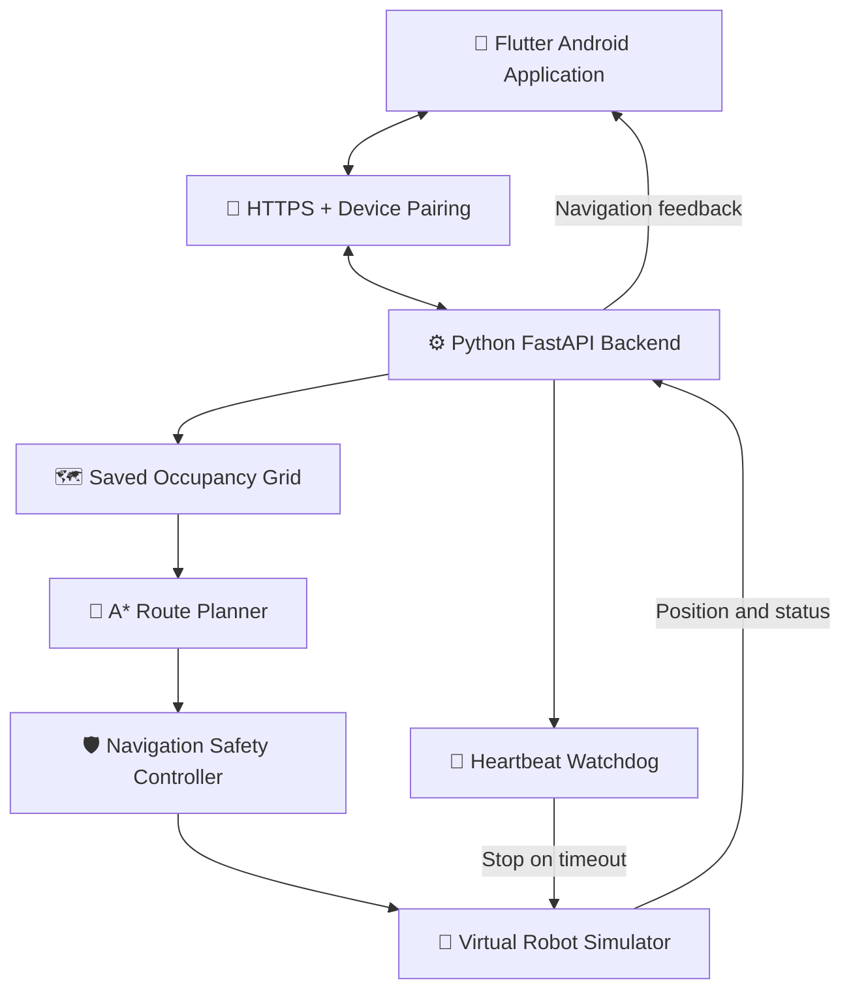

<div align="center">

# 🚗 AutoNav RC
### Intelligent Indoor Autonomous Navigation System

**An Android-controlled autonomous RC car project built with Flutter, Python, FastAPI, occupancy-grid mapping, and A* path planning.**

<br>

[](https://ashiwany25.github.io/AutoNav-RC-Website/)
[](https://github.com/Ashiwany25/AutoNav-RC-Website)

<br>


**Project Status:** Working Android Simulator | Physical RC Car Development Planned

</div>

---

## 🌐 Live Demo & Project Links

| Resource | Link |
|---|---|
| 🌍 **Live Website** | **[Open AutoNav RC Website](https://ashiwany25.github.io/AutoNav-RC-Website/)** |
| 💻 **GitHub Repository** | **[View Complete Project Source](https://github.com/Ashiwany25/AutoNav-RC-Website)** |
| 📱 **Android Demo Release** | **[View Available Releases](https://github.com/Ashiwany25/AutoNav-RC-Website/releases)** |
| 🧪 **Automated Tests** | [View Python Tests](https://github.com/Ashiwany25/AutoNav-RC-Website/tree/main/tests) |
| 📲 **Flutter Application** | [View Android Source](https://github.com/Ashiwany25/AutoNav-RC-Website/tree/main/mobile_app/autonav_rc/lib) |

> **Note:** The existing APK is a development simulator build. It requires the configured local FastAPI backend and is not yet a universal controller for physical RC cars.

---

## 📌 Project Overview

**AutoNav RC** is an indoor autonomous navigation project designed to let users control a robotic vehicle through an Android application.

The long-term objective is to create a physical RC car capable of exploring an indoor environment, generating a map, identifying safe routes, and automatically navigating to any reachable destination selected by the user.

The current implementation demonstrates these capabilities through an Android-connected Python simulator.

### Core objectives

- Create and visualize indoor occupancy-grid maps.
- Allow users to select destinations by tapping the Android map.
- Generate safe routes using the **A* pathfinding algorithm**.
- Simulate autonomous movement along planned routes.
- Replan routes when obstacles or destinations change.
- Provide reliable STOP commands and connection monitoring.
- Build toward sensor-based autonomous navigation on a physical RC car.

---

## ✨ Key Features

| Feature | Description | Status |
|---|---|---|
| 📱 Android application | Flutter-based user interface | ✅ Working |
| 🌐 Wi-Fi communication | Android-to-FastAPI connectivity | ✅ Working |
| 🔒 HTTPS and pairing | Certificate-based HTTPS and pairing-token authentication | ✅ Working in development |
| 🗺️ Indoor map | Saved occupancy-grid visualization | ✅ Working |
| 🎯 Tap-to-go | Select safe reachable destinations | ✅ Working in simulator |
| 🧭 A* path planning | Find routes through safe cells | ✅ Working |
| 🚧 Dynamic obstacles | Update obstacles and replan routes | ✅ Implemented in simulation |
| 🔄 Destination updates | Change destination during navigation | ✅ Implemented |
| 🛑 STOP navigation | Stop virtual movement and verify state | ✅ Tested |
| 💓 Heartbeat watchdog | Detect loss of controller communication | ✅ Automated tests passed |
| 📦 Android APK | Standalone Android development build | ✅ Built and tested |
| 🤖 Physical RC car | Real sensor and motor integration | 🔄 Planned |

---

## 🏗️ System Architecture



### How the system works

1. The user opens the AutoNav RC application.
2. The phone connects to the local FastAPI controller over HTTPS.
3. The user selects a destination on the saved indoor map.
4. The backend validates the destination and calculates a safe route.
5. The virtual robot follows the planned path.
6. Updated position and navigation status appear in the Android app.
7. The user can stop navigation or choose another destination.
8. The heartbeat watchdog monitors connectivity during navigation.

---

## 🗂️ Project Structure

```text
AutoNav-RC-Website/
│
├── api/
│   ├── main.py
│   ├── local_pairing.py
│   ├── saved_map_simulator.py
│   └── ...
│
├── navigation/
│   └── Python navigation and safety modules
│
├── mapping/
│   └── Indoor mapping modules
│
├── mobile_app/
│   └── autonav_rc/
│       ├── lib/
│       │   ├── screens/
│       │   ├── services/
│       │   └── main.dart
│       ├── test/
│       └── pubspec.yaml
│
├── tests/
│   └── Python backend tests
│
├── media/
│   └── Website screenshots and demo media
│
├── index.html
├── README.md
└── .gitignore
```

---

## 🛠️ Technology Stack

| Category | Technologies |
|---|---|
| Mobile application | Flutter, Dart |
| Backend API | Python, FastAPI |
| Route planning | A* Algorithm |
| Environment representation | 2D Occupancy Grid |
| Obstacle handling | Safety checks and dynamic replanning |
| Network communication | HTTP, HTTPS |
| Authentication | Device pairing, bearer tokens |
| Testing | Python unittest, Flutter Test |
| Android deployment | Flutter Release APK |
| Website hosting | GitHub Pages |
| Version control | Git, GitHub |

---

## 🧪 Testing & Validation

The latest reported development tests completed successfully.

<div align="center">

| Verification | Result |
|---|---|
| Python backend tests | ✅ 82 Passed |
| Flutter tests | ✅ 104 Passed |
| **Total automated tests** | **✅ 186 Passed** |
| Flutter static analysis | ✅ No issues |
| Android APK release build | ✅ Successful |
| Wi-Fi connectivity without USB | ✅ Verified |
| Navigation arrival state | ✅ `ARRIVED` |
| Navigation STOP state | ✅ `STOPPED` |

</div>

Tests cover API requests, A* navigation, obstacle safety, destination changes, local pairing, heartbeat handling, simulator state transitions, and Flutter interface behavior.

**Testing limitation:** The successful tests validate the current software simulator and development environment, not the safety of an actual physical vehicle.

---

## 📲 Android Application

The Flutter application provides interfaces for:

- Manual Control
- Indoor Map
- Saved Map Navigation
- Controller Connection Settings
- Device Pairing
- Dynamic Obstacle Simulation
- STOP Navigation

The development application has been tested on an Android phone over a local Wi-Fi connection.

### Android application source

**[Explore the Flutter App →](https://github.com/Ashiwany25/AutoNav-RC-Website/tree/main/mobile_app/autonav_rc/lib)**

### Development APK

**[Check GitHub Releases →](https://github.com/Ashiwany25/AutoNav-RC-Website/releases)**

APK availability depends on whether a release asset has been published.

---

## 🚀 Getting Started

### Prerequisites

- Python and pip
- Flutter SDK
- Android SDK
- Android phone or emulator
- Local Wi-Fi network
- Project dependencies
- Development HTTPS certificate configured for the backend

### 1. Clone the repository

```bash
git clone https://github.com/Ashiwany25/AutoNav-RC-Website.git
cd AutoNav-RC-Website
```

### 2. Set up the Python backend

```bash
python3 -m venv .venv
source .venv/bin/activate
```

Install the required dependencies for your local project environment.

### 3. Start the local backend

The existing development setup uses FastAPI, device pairing, dedicated heartbeats, and HTTPS.

The HTTPS certificate and private key must be configured locally. Private keys are intentionally not provided in this repository.

### 4. Open the Flutter application

```bash
cd mobile_app/autonav_rc
flutter pub get
flutter run
```

Configure the backend address and trusted development certificate as required.

**Important:** The uploaded source is a development snapshot. Additional Android platform files and local configuration may be required for a clean build on a new machine.

---

## 🛡️ Safety Mechanisms

AutoNav RC includes multiple software safety measures for simulation:

- Destination validation before navigation
- Obstacle-clearance checks
- Rejection of unknown and occupied map cells
- Dedicated heartbeat monitoring
- STOP command handling
- Navigation-state verification
- Controller pairing and basic ownership checks
- Prevention of automatic navigation restart after certain connection failures

These mechanisms are currently designed and tested for the simulator.

A physical RC car will require additional motor-level emergency stop, hardware watchdogs, reliable sensor feedback, and real-world safety testing.

---

## 🧭 Development Roadmap

- [x] Flutter Android interface
- [x] Python FastAPI backend
- [x] Saved indoor occupancy-grid simulation
- [x] A* route planning
- [x] Dynamic obstacle replanning
- [x] Destination update support
- [x] HTTPS pairing and controller authentication
- [x] Dedicated heartbeat monitoring
- [x] STOP-state verification
- [x] Standalone development APK
- [x] Public GitHub Pages website
- [ ] General-purpose secure controller onboarding
- [ ] ESP32 and motor-driver integration
- [ ] Real distance-sensor integration
- [ ] Wheel odometry and localization
- [ ] Real indoor map generation
- [ ] Physical autonomous tap-to-go navigation
- [ ] Multi-environment performance and safety evaluation

---

## ⚠️ Current Limitations

AutoNav RC is currently a **software-based indoor navigation simulator**.

The project does not yet include a fully assembled autonomous RC car, real sensor-based localization, physical motor control, or validated autonomous driving in an actual house.

The development APK is configured for a specific backend and should not be considered a general-purpose consumer application.

---

## 🌍 Explore the Project

<div align="center">

### Want to see AutoNav RC in action?

**[🌐 VISIT LIVE WEBSITE](https://ashiwany25.github.io/AutoNav-RC-Website/)**

**[💻 VIEW GITHUB SOURCE CODE](https://github.com/Ashiwany25/AutoNav-RC-Website)**

**[📱 EXPLORE ANDROID APP CODE](https://github.com/Ashiwany25/AutoNav-RC-Website/tree/main/mobile_app/autonav_rc/lib)**

---

**Built with Flutter, Python, FastAPI, and A* Path Planning**

*AutoNav RC — Mapping indoor environments. Planning safe paths. Moving toward autonomous navigation.*

</div>
