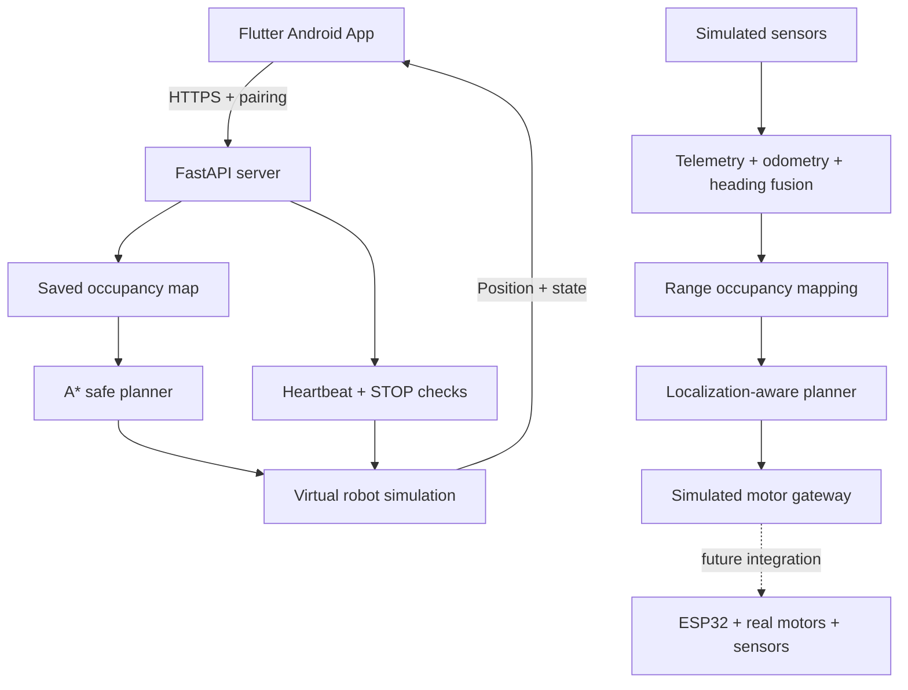

<div align="center">

# 🚗 AutoNav RC

### Indoor Autonomous Navigation • Flutter • FastAPI • A* • Sensor Fusion

**Android-controlled indoor navigation simulator with offline-tested hardware integration modules.**

[](https://ashiwany25.github.io/AutoNav-RC-Website/)
[](https://github.com/Ashiwany25/AutoNav-RC-Website)


**[🌐 Live project website](https://ashiwany25.github.io/AutoNav-RC-Website/) · [📁 Source code](https://github.com/Ashiwany25/AutoNav-RC-Website) · [📱 Android app source](mobile_app/autonav_rc/lib) · [🧪 Tests](tests)**

</div>

---

## Project at a glance

**AutoNav RC** aims to teach an indoor environment to a small car and then navigate to arbitrary reachable map locations selected from an Android phone. The **current deliverable is a working phone-connected virtual-robot simulator**, plus offline software foundations for real sensor/motor integration. This repository is **not** a finished physical autonomous car.

| Subsystem | Current stage |
|---|---|
| Android Flutter app, local HTTPS pairing and navigation controls | ✅ Tested in development |
| A* safe route planning, saved maps and dynamic re-planning | ✅ Simulator-tested |
| Live simulator states: `NAVIGATING`, `ARRIVED`, `STOPPED`, connection loss | ✅ Development-tested |
| Telemetry decoding, wheel odometry and IMU heading fusion | ✅ Offline-tested |
| Simulated range-to-grid mapping and localization-aware planning | ✅ Offline-tested |
| Serial motor protocol and simulated motor gateway | ✅ Offline safety foundation |
| ESP32 live motor firmware, real SLAM and physical safety | ⏳ Not implemented or validated end to end |

## Watch and explore

**[Visit the interactive project website](https://ashiwany25.github.io/AutoNav-RC-Website/)** for the project explanation, demonstrations and any media currently published. The interactive website map is a browser simulation, not a live physical robot. If available, videos/screenshots are from the development app.

## Architecture



## Features

- 📱 **Standalone Android APK** tested on a Samsung device over local Wi-Fi without USB.
- 🗺️ **Teach/saved-map simulator** with free, occupied and unknown cells.
- 🎯 **Tap-to-go:** choose any known reachable safe destination on the demo map.
- 🧭 **A* path planner** with obstacle clearance, destination updates and replanning.
- 🛑 **STOP and heartbeat safety controls** verified for the virtual robot.
- 🔐 **Local HTTPS and pairing-token authentication** for the development backend.
- 🔧 **Hardware-facing software** for telemetry validation, wheel odometry, heading fusion and motor-gateway safety, validated offline only.

## Tests and validation

| Check | Last reported result |
|---|---|
| Python backend and offline integration tests | 146 passed |
| Flutter widget/unit tests | 106 passed |
| Flutter static analysis | No issues |
| Wi-Fi Android simulator navigation | `ARRIVED` verified |
| Simulator STOP | `STOPPED` verified |

*Results reflect separate local runs across development stages; they are not a single verified CI run and do not prove physical driving safety. CI status should be checked in GitHub Actions.*

## Repository structure

```text
api/                       # FastAPI, pairing, navigation API
navigation/                # A* planning, clearance and localization gate
mapping/                   # Teach mode and range-grid mapping
hardware/                  # Telemetry, odometry, heading fusion, safe gateway
simulation/                # Virtual robot and visualization tools
tests/                     # Python regression tests
mobile_app/autonav_rc/     # Flutter Android UI and widget tests
docs/                      # Reproducibility and security
index.html                 # GitHub Pages home page
media/                     # Existing website media (when present)
```

## Run locally

```bash
# From the repository root
python3 -m venv .venv
source .venv/bin/activate
python -m pip install -r requirements-dev.txt
python -m unittest discover -s tests -q
```

For the Flutter application:

```bash
cd mobile_app/autonav_rc
flutter pub get
flutter analyze
flutter test
```

**Connection setup is development-specific:** Flutter's HTTPS client expects a separately provisioned certificate asset, and the current Android controller connects to a configured backend, not an arbitrary buyer's car. Review [reproducibility notes](docs/REPRODUCIBILITY.md) before building or distributing. Never disable certificate validation to bypass onboarding.

## Documentation

- [Setup and reproducibility](docs/REPRODUCIBILITY.md)
- [Security and limitations](docs/SECURITY.md)
- [Python automated tests](tests)
- [Flutter app code](mobile_app/autonav_rc/lib)
- [Project website](https://ashiwany25.github.io/AutoNav-RC-Website/)

## Roadmap

- [x] Android app and FastAPI simulator
- [x] Safe A* navigation, saved map and STOP behavior
- [x] Local pairing and dedicated heartbeat
- [x] Standalone development Android APK
- [x] Sensor-data validation and relative odometry modules
- [x] Simulated mapping, pose validation and motor-command gateway
- [ ] Secure onboarding and certificate provisioning for different cars
- [ ] Real ESP32 motor drivers and independent physical E-stop/watchdog
- [ ] Calibrated encoders, IMU, range sensors and on-device localization
- [ ] Real indoor mapping and repeatable physical tap-to-go tests

---

<div align="center">

### [🌐 Open AutoNav RC Website](https://ashiwany25.github.io/AutoNav-RC-Website/)

**A working navigation simulator today — a hardware-integrated indoor autonomous car is the next milestone.**

</div>
