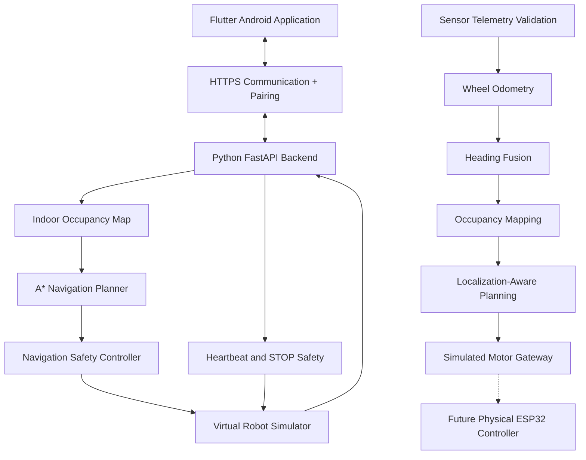

<div align="center">

# 🚗 AutoNav RC
### Intelligent Indoor Autonomous Navigation System

**An Android-controlled autonomous robotics project featuring occupancy-grid mapping, A* path planning, sensor fusion, localization, and safety-aware navigation.**

<br>

[](https://ashiwany25.github.io/AutoNav-RC-Website/)
[](https://github.com/Ashiwany25/AutoNav-RC-Website)

<br>


<br>


---

### 🌐 [Visit Live Website](https://ashiwany25.github.io/AutoNav-RC-Website/) | 💻 [Explore Source Code](https://github.com/Ashiwany25/AutoNav-RC-Website)

</div>

## 📖 About the Project

**AutoNav RC** is an indoor autonomous navigation project designed to build a robotic vehicle capable of learning an indoor environment and navigating autonomously to any reachable destination selected through an Android application.

The project combines:

- **Flutter** for Android-based control and visualization.
- **FastAPI** for backend communication and navigation services.
- **A* pathfinding** for obstacle-aware route planning.
- **Occupancy-grid mapping** for representing indoor environments.
- **Wheel odometry and heading fusion** for position estimation.
- **Sensor telemetry validation** for future hardware integration.
- **Watchdog-based safety mechanisms** for reliable movement control.

The current implementation includes a working Android-connected navigation simulator and offline-tested hardware-facing software modules.

> **Development status:** Simulator and offline software integration milestones completed. Physical RC car hardware integration and real-world autonomous navigation validation remain pending.

---

## ✨ Key Features

| Feature | Description | Status |
|---|---|---|
| 📱 Android application | Flutter-based controller | ✅ Tested |
| 📡 Wi-Fi communication | Local Android-to-backend connection | ✅ Tested |
| 🔐 HTTPS pairing | Authentication and controller verification | ✅ Development-tested |
| 🗺️ Saved indoor mapping | Occupancy-grid representation | ✅ Simulator-tested |
| 🎯 Tap-to-go navigation | Select a safe destination on the map | ✅ Simulator-tested |
| 🧭 A* route planning | Safe route generation | ✅ Tested |
| 🚧 Dynamic obstacles | Obstacle updates and route replanning | ✅ Simulator-tested |
| 🔄 Destination updates | Change destinations while navigating | ✅ Tested |
| 🛑 STOP command | Verified simulator stopping behavior | ✅ Tested |
| 💓 Heartbeat watchdog | Detect communication loss | ✅ Tested |
| ⚙️ Motor-command protocol | Hardware communication foundation | ✅ Offline-tested |
| 📊 Sensor telemetry | Validate sensor readings | ✅ Offline-tested |
| ⚙️ Wheel odometry | Estimate relative robot motion | ✅ Offline-tested |
| 🧭 Heading fusion | Combine simulated heading estimates | ✅ Offline-tested |
| 📡 Range-based mapping | Generate occupancy information | ✅ Offline-tested |
| 🗺️ Localization-aware planning | Use validated pose estimates | ✅ Offline-tested |
| 🔌 ESP32 integration | Real hardware communication and control | ⏳ Pending |
| 🤖 Physical autonomy | Navigate a real indoor environment | ⏳ Pending |

---

## 🏗️ System Architecture



**Architecture note:** The Android/FastAPI simulator is operational. The sensor-processing and hardware-interface modules have been tested offline; their end-to-end connection to physical hardware remains future work.

---

## 🛠️ Technology Stack

| Layer | Technologies |
|---|---|
| Android development | Flutter, Dart |
| Backend | Python, FastAPI |
| Path planning | A* Algorithm |
| Indoor mapping | Occupancy Grid |
| Relative localization | Wheel Odometry |
| Orientation estimation | Heading Fusion |
| Sensor processing | Telemetry Validation |
| Safety | STOP, Heartbeat Watchdog |
| Authentication | HTTPS, Pairing Tokens |
| Hardware preparation | Serial Motor Protocol, ESP32 Scaffold |
| Automated testing | Python unittest, Flutter Test |
| Deployment | Android APK, GitHub Pages |
| Version control | Git, GitHub |

---

## 📁 Project Structure

```text
AutoNav-RC-Website/
│
├── api/
│   ├── main.py
│   ├── local_pairing.py
│   ├── saved_map_simulator.py
│   └── ...
│
├── navigation/
│   └── A* planning and safety modules
│
├── mapping/
│   └── Indoor mapping and estimation modules
│
├── tests/
│   └── Python automated tests
│
├── mobile_app/
│   └── autonav_rc/
│       ├── lib/
│       │   ├── screens/
│       │   ├── services/
│       │   └── main.dart
│       ├── test/
│       └── pubspec.yaml
│
├── media/
│   └── Website demonstration media
│
├── index.html
├── README.md
└── .gitignore
```

Some hardware-integration source files may exist only in the latest local development project until they are pushed to GitHub.

---

## 🧠 Algorithms and Techniques

### 1. A* Pathfinding

The navigation planner searches for a safe route between the robot's current position and a selected destination.

It considers explored free cells, obstacles, and the configured obstacle-clearance rules.

### 2. Occupancy Grid Mapping

The environment is represented using grid cells.

- **Free:** Traversable space.
- **Occupied:** Detected obstacle.
- **Unknown:** Not yet explored.

Unknown regions are treated conservatively during navigation.

### 3. Dynamic Obstacle Replanning

When obstacles change in the simulator, the navigation controller evaluates whether the existing route remains safe and can calculate an alternative route.

### 4. Wheel Odometry

Encoder measurements are used to estimate relative robot displacement and turning.

The current odometry module is tested with simulated measurements.

### 5. Heading Fusion

Heading estimates from wheel odometry and simulated IMU measurements are combined, with validation for stale or implausible readings.

### 6. Localization-Aware Planning

The planning foundation uses validated pose information and rejects unsafe localization conditions.

### 7. Safety Monitoring

The system includes:

- Emergency STOP command handling.
- Heartbeat monitoring.
- Connection-loss detection.
- Navigation-state verification.
- Obstacle-clearance checks.
- Command validation.
- Simulated motor watchdog behavior.

Physical safety mechanisms will require independent testing on real hardware.

---

## 🧪 Testing and Validation

### Latest development results

| Test Suite | Reported Result |
|---|---|
| Python backend + integration tests | ✅ 146 Passed |
| Flutter automated tests | ✅ 106 Passed |
| Flutter static analysis | ✅ No issues |
| Standalone Android APK | ✅ Built and tested |
| Android Wi-Fi connectivity | ✅ Verified |
| Autonomous simulator arrival | ✅ ARRIVED |
| Simulator STOP | ✅ STOPPED |
| Sensor telemetry tests | ✅ Passed |
| Odometry and heading-fusion tests | ✅ Passed |
| Offline mapping and navigation integration | ✅ Passed |

**Note:** The 146 Python tests and 106 Flutter tests were verified at different development stages. They should be rerun together after the latest changes before declaring a new final release.

### Run Python tests

```bash
python -m unittest discover -s tests -q
```

### Run Flutter tests

```bash
cd mobile_app/autonav_rc

flutter analyze
flutter test
```

---

## 📲 Android Application

The Flutter application provides:

- Manual Control interface
- Indoor Map visualization
- Saved Map Navigation
- Destination selection
- Live simulator position updates
- Controller Connection Settings
- Device Pairing
- Navigation STOP
- Dynamic Obstacle Simulation

### Source code

[View Flutter Android Application](https://github.com/Ashiwany25/AutoNav-RC-Website/tree/main/mobile_app/autonav_rc/lib)

### Android releases

[Check Available Development APKs](https://github.com/Ashiwany25/AutoNav-RC-Website/releases)

The development APK requires its configured local controller and HTTPS certificate.

---

## 🚀 Getting Started

### Requirements

- Python
- Flutter SDK
- Android SDK
- Android phone
- Local Wi-Fi network
- Project dependencies
- Locally configured HTTPS certificate and private key

### Clone

```bash
git clone https://github.com/Ashiwany25/AutoNav-RC-Website.git
cd AutoNav-RC-Website
```

### Python environment

```bash
python3 -m venv .venv
source .venv/bin/activate
```

Install the required dependencies for the backend environment.

### Flutter application

```bash
cd mobile_app/autonav_rc
flutter pub get
flutter run
```

**Setup limitation:** The public repository is a development-source snapshot and may require locally generated Android platform files, dependencies, controller configuration, and trusted certificates to build on a new machine.

The default development controller configuration is not a production-ready device-onboarding system.

---

## 🛡️ Safety and Security

AutoNav RC uses local HTTPS authentication, device pairing, and navigation safety mechanisms.

The software is designed to reject invalid navigation targets and prevent unsafe simulator behavior when movement commands or heartbeat messages fail validation.

However, **simulation safety is not equivalent to physical vehicle safety**.

Before operating real motors, the project must implement and test:

- Hardware-level emergency stop.
- Motor-controller watchdog.
- Sensor failure handling.
- Power-system protection.
- Safe startup and shutdown.
- Reliable physical localization.
- Collision avoidance on real hardware.

---

## 🗺️ Development Roadmap

### Phase 1 — Android Application and Simulator

- [x] Flutter Android interface
- [x] FastAPI backend
- [x] Saved occupancy map
- [x] A* route planning
- [x] Autonomous navigation simulation
- [x] STOP control
- [x] Local HTTPS and pairing
- [x] Standalone Android APK

### Phase 2 — Hardware-Facing Software Foundations

- [x] Motor-command protocol foundation
- [x] Sensor telemetry validation
- [x] Wheel odometry
- [x] Heading fusion
- [x] Simulated range-based occupancy mapping
- [x] Localization-aware route planning foundation
- [x] Simulated motor-command gateway
- [x] Offline integration tests

### Phase 3 — Physical Robot Integration

- [ ] Assemble physical RC car
- [ ] Integrate ESP32 and motor driver
- [ ] Implement and validate real motor-control firmware
- [ ] Connect wheel encoders, IMU and distance sensors
- [ ] Calibrate odometry and sensors
- [ ] Implement reliable real-world indoor localization and mapping
- [ ] Integrate live sensor-based obstacle avoidance
- [ ] Validate arbitrary destination navigation in multiple indoor environments
- [ ] Complete hardware safety testing

### Phase 4 — Public Device Support

- [ ] Secure per-device controller onboarding
- [ ] General-purpose configuration for different cars
- [ ] Production certificate provisioning
- [ ] Final public Android release

---

## ⚠️ Current Project Limitations

The project currently demonstrates **autonomous indoor navigation in simulation** and includes offline-tested software foundations for future hardware integration.

It does not yet demonstrate fully autonomous navigation on a physical RC car.

The project is intended for robotics learning, research, prototyping, and further development.

---

<div align="center">

## 🌐 Explore AutoNav RC

### [Visit Live Website](https://ashiwany25.github.io/AutoNav-RC-Website/)

### [View Complete GitHub Repository](https://github.com/Ashiwany25/AutoNav-RC-Website)

### [Explore Android App Source](https://github.com/Ashiwany25/AutoNav-RC-Website/tree/main/mobile_app/autonav_rc/lib)

---

**Built with Flutter, Python, FastAPI, A* Navigation, and Robotics Algorithms**

*AutoNav RC — Mapping indoor spaces. Planning safe routes. Building toward physical autonomy.*

</div>
