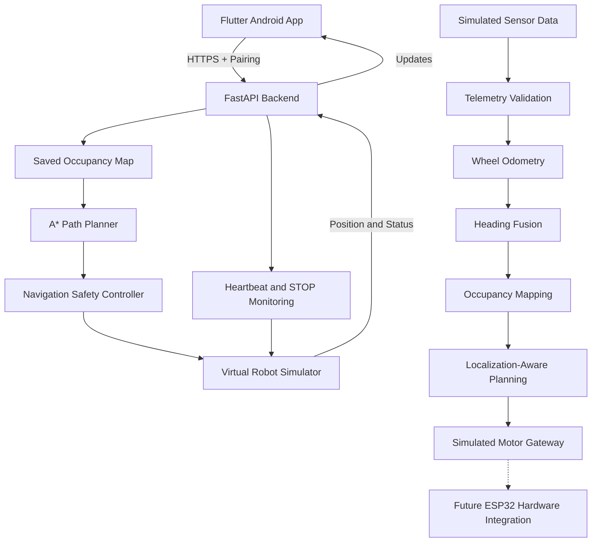

<div align="center">

# 🚗 AutoNav RC

### Android-Controlled Indoor Autonomous Navigation System

**A robotics project combining Flutter, FastAPI, A* path planning, indoor mapping, localization, and sensor fusion.**

[](https://ashiwany25.github.io/AutoNav-RC-Website/)
[](https://github.com/Ashiwany25/AutoNav-RC-Website)
[](https://github.com/Ashiwany25/AutoNav-RC-Website/actions)

<br>


**Current Status: Working Android Navigation Simulator + Offline-Tested Hardware Integration Modules**

**Physical Autonomous RC Car: Hardware Integration Pending**

[Live Demo Website](https://ashiwany25.github.io/AutoNav-RC-Website/) · [Source Code](https://github.com/Ashiwany25/AutoNav-RC-Website) · [Android App](mobile_app/autonav_rc/lib) · [Automated Tests](tests)

</div>

---

## 📖 Project Overview

**AutoNav RC** is an indoor autonomous navigation project designed to develop a small robotic car that can map an indoor environment and automatically navigate to a destination selected from an Android application.

The intended physical car will support two primary modes:

- **Teach Mode:** Manually explore an indoor environment and create a reusable map.
- **Autonomous Mode:** Tap any known, reachable, safe destination on the map and let the robot plan a route.

The current prototype demonstrates these navigation concepts using an Android-connected virtual robot simulator.

It also includes offline-tested software components for future physical integration, including wheel odometry, heading fusion, sensor telemetry, occupancy mapping, and motor-command safety.

> **Important:** The current project is a working navigation simulator and hardware-integration software prototype, not yet a fully functional physical autonomous vehicle.

---

## ✨ Key Features

| Feature | Description | Current Status |
|---|---|---|
| Android Application | Flutter-based robot control interface | ✅ Development-tested |
| Local Wi-Fi Communication | Phone-to-backend communication | ✅ Development-tested |
| HTTPS and Pairing | Development controller authentication | ✅ Development-tested |
| Indoor Map | Virtual occupancy-grid environment | ✅ Simulator-tested |
| Teach / Saved Map | Map creation and reuse in the simulator | ✅ Simulator-tested |
| Tap-to-Go Navigation | Select a reachable destination | ✅ Simulator-tested |
| A* Pathfinding | Calculate obstacle-aware routes | ✅ Tested |
| Dynamic Replanning | Update navigation when obstacles change | ✅ Simulator-tested |
| Destination Updates | Change targets during navigation | ✅ Simulator-tested |
| Emergency STOP | Stop virtual robot movement | ✅ Simulator-tested |
| Heartbeat Monitoring | Detect controller communication loss | ✅ Tested |
| Sensor Telemetry | Validate simulated sensor messages | ✅ Offline-tested |
| Wheel Odometry | Estimate relative robot movement | ✅ Offline-tested |
| IMU Heading Fusion | Combine simulated heading estimates | ✅ Offline-tested |
| Occupancy Mapping | Convert simulated range data into grid information | ✅ Offline-tested |
| Localization-Aware Planning | Reject navigation with invalid pose data | ✅ Offline-tested |
| Motor Gateway | Validate simulated movement commands | ✅ Offline-tested |
| Real ESP32 Control | Connect software to physical motor hardware | ⏳ Pending |
| Real Indoor SLAM | Reliable mapping and localization in an actual house | ⏳ Pending |
| Physical Autonomous Driving | Navigate using real sensors and motors | ⏳ Pending |

---

## 🏗️ System Architecture



### Architecture Explanation

**Android Application:** Provides navigation controls, map visualization, destination selection, and robot status.

**FastAPI Backend:** Handles communication and simulator control.

**Mapping System:** Maintains a grid-based representation of the environment.

**A* Planner:** Searches for a safe route between the current position and destination.

**Safety Controller:** Validates movement conditions and handles STOP or connection-loss behavior.

**Sensor Processing Modules:** Prepare telemetry, odometry, heading estimation, and mapping for future hardware integration.

---

## 🧠 Algorithms and Robotics Concepts

### 1. A* Pathfinding

A* searches for a route from the robot's current grid cell to a selected target.

The planner uses available map information and obstacle-clearance constraints to avoid blocked regions.

### 2. Occupancy Grid Mapping

Indoor space is represented using grid cells:

- **Free:** Known traversable space.
- **Occupied:** Detected obstacle.
- **Unknown:** Unexplored space.

Unknown cells are handled conservatively during route planning.

### 3. Dynamic Route Replanning

When an obstacle or selected destination changes, the simulator can calculate an updated route.

### 4. Wheel Odometry

Wheel-encoder readings are used to estimate relative movement and changes in robot orientation.

The current implementation is validated using simulated measurements.

### 5. Heading Fusion

Simulated IMU and odometry heading measurements are combined to estimate the robot's orientation.

The module validates stale, duplicate, or implausible readings.

### 6. Localization-Aware Navigation

The navigation system checks position estimates before allowing route planning.

Invalid or untrusted localization data is rejected.

### 7. Safety Mechanisms

The software includes development-tested foundations for:

- Emergency STOP
- Heartbeat timeout detection
- Communication-loss handling
- Obstacle-clearance checks
- Invalid destination rejection
- Motor-command validation
- Simulated motor watchdog behavior

Physical safety requires separate hardware-level implementation and testing.

---

## 🛠️ Technology Stack

| Category | Technology |
|---|---|
| Mobile Application | Flutter, Dart |
| Backend | Python, FastAPI |
| Communication | Local HTTPS |
| Authentication | Pairing Tokens |
| Path Planning | A* Algorithm |
| Mapping | Occupancy Grids |
| Localization | Wheel Odometry |
| Orientation Estimation | Heading Fusion |
| Hardware Preparation | ESP32, Serial Protocol |
| Testing | Python unittest, Flutter Test |
| Website Hosting | GitHub Pages |
| Version Control | Git, GitHub |

---

## 📁 Repository Structure

```text
AutoNav-RC-Website/
│
├── .github/
│   └── workflows/          # Automated GitHub tests
│
├── api/                    # FastAPI backend and pairing
├── navigation/             # Route planning and safety
├── mapping/                # Occupancy mapping modules
├── hardware/               # Sensor and motor interface foundations
├── simulation/             # Virtual robot simulation
├── tests/                  # Python automated tests
│
├── mobile_app/
│   └── autonav_rc/         # Flutter Android application
│       ├── lib/
│       ├── test/
│       └── pubspec.yaml
│
├── docs/                   # Setup and security documentation
├── media/                  # Project demonstration media
│
├── index.html              # GitHub Pages website
├── requirements-dev.txt
├── .gitignore
└── README.md
```

---

## 📱 Android Application

The Android application provides a mobile interface for controlling the virtual robot.

### Application Features

- Manual Control screen
- Indoor Map screen
- Autonomous Navigation controls
- Destination selection
- Robot position and status monitoring
- Connection and pairing controls
- Emergency STOP

A standalone development APK has been built and tested on an Android phone over local Wi-Fi.

The current APK uses development-specific controller and certificate configuration. It is not yet a universal app for connecting to arbitrary physical cars.

**Explore:** [Flutter Application Source](mobile_app/autonav_rc/lib)

---

## 🧪 Testing and Validation

The project includes automated Python and Flutter tests.

| Test Category | Last Reported Result |
|---|---|
| Python Backend and Integration Tests | ✅ 146 Passed |
| Flutter Unit and Widget Tests | ✅ 106 Passed |
| Flutter Static Analysis | ✅ No Issues |
| Android Wi-Fi Navigation Simulation | ✅ Tested |
| Simulator Destination Arrival | ✅ `ARRIVED` |
| Simulator Emergency STOP | ✅ `STOPPED` |
| Sensor Telemetry Validation | ✅ Passed |
| Wheel Odometry | ✅ Passed |
| Heading Fusion | ✅ Passed |
| Occupancy Mapping | ✅ Passed |
| Localization-Aware Planning | ✅ Passed |

**Testing note:** Results reflect reported local development runs. Python and Flutter suites were not all verified in a single final CI execution. Passing simulator tests does not establish physical vehicle safety.

### Run Python Tests

```bash
python3 -m venv .venv
source .venv/bin/activate

python -m pip install -r requirements-dev.txt

python -m unittest discover -s tests -q
```

### Run Flutter Tests

```bash
cd mobile_app/autonav_rc

flutter pub get

flutter analyze

flutter test
```

See [Setup and Reproducibility](docs/REPRODUCIBILITY.md) for additional requirements.

---

## 🚀 Installation and Local Development

### Prerequisites

- Python
- Flutter SDK
- Android SDK
- Git
- Android phone or emulator
- Local network for phone-to-backend testing

### Clone the Repository

```bash
git clone https://github.com/Ashiwany25/AutoNav-RC-Website.git

cd AutoNav-RC-Website
```

### Create Python Environment

```bash
python3 -m venv .venv

source .venv/bin/activate

python -m pip install -r requirements-dev.txt
```

### Open Flutter Application

```bash
cd mobile_app/autonav_rc

flutter pub get

flutter run
```

### Development Configuration

The Android HTTPS connection requires correctly configured controller settings and a separately provisioned certificate.

A fresh clone may require additional Android platform setup and certificate provisioning before the app can connect successfully.

**Do not disable TLS verification or upload private certificates, tokens, or credentials to GitHub.**

---

## 🔒 Security and Safety

AutoNav RC uses local communication, controller authentication, and navigation safety checks.

Development-tested protections include:

- HTTPS communication
- Pairing-token authentication
- Heartbeat validation
- STOP command handling
- Navigation target validation
- Simulated motor watchdog behavior

### Physical Hardware Safety Requirements

Before real motors are enabled, the project must implement and test:

- Independent emergency-stop circuitry
- Hardware motor watchdog
- Safe power distribution
- Motor-driver current protection
- Sensor failure detection
- Physical collision prevention
- Reliable real-time localization

Read [Security and Limitations](docs/SECURITY.md).

---

## 🗺️ Development Roadmap

### Phase 1 — Android and Navigation Simulator

- [x] Flutter Android application
- [x] FastAPI backend
- [x] Local HTTPS and pairing
- [x] Indoor grid-map simulator
- [x] A* route planning
- [x] Destination selection
- [x] Dynamic replanning
- [x] STOP and heartbeat monitoring
- [x] Standalone development APK

### Phase 2 — Hardware Software Foundations

- [x] Sensor telemetry validation
- [x] Wheel odometry
- [x] Heading fusion
- [x] Simulated occupancy mapping
- [x] Localization-aware planning
- [x] Motor-command protocol foundation
- [x] Simulated motor gateway
- [x] Offline integration testing

### Phase 3 — Physical RC Car Integration

- [ ] Select and assemble hardware
- [ ] Integrate ESP32 controller
- [ ] Implement real motor-control firmware
- [ ] Install and calibrate wheel encoders
- [ ] Connect IMU and distance sensors
- [ ] Develop reliable real-world indoor mapping
- [ ] Implement localization and obstacle avoidance
- [ ] Validate physical tap-to-go navigation
- [ ] Complete hardware safety testing

### Phase 4 — Public Device Support

- [ ] Secure pairing for independently purchased cars
- [ ] Production device certificate provisioning
- [ ] General-purpose controller configuration
- [ ] Final public Android APK release
- [ ] Multi-environment physical testing

---

## 📚 Documentation

- [Setup and Reproducibility](docs/REPRODUCIBILITY.md)
- [Security and Limitations](docs/SECURITY.md)
- [Python Automated Tests](tests)
- [Flutter Source Code](mobile_app/autonav_rc/lib)
- [Live Project Website](https://ashiwany25.github.io/AutoNav-RC-Website/)

---

## 🌟 Project Goals

The long-term objective is to create a compact indoor autonomous robot that can:

1. Learn a house layout through manual exploration.
2. Save the indoor map for later use.
3. Estimate its position using onboard sensors.
4. Allow users to select any safe reachable destination.
5. Navigate automatically while avoiding obstacles.
6. Replan when the environment changes.
7. Stop safely when an emergency or sensor failure occurs.

These goals guide ongoing physical hardware integration.

---

## ⚠️ Current Limitations

AutoNav RC currently operates as a navigation simulator with additional offline-tested robotics software modules.

Real sensor drivers, robust indoor SLAM, hardware-level motor control, and autonomous operation on an actual RC car are not yet fully implemented or validated.

This project is intended for educational robotics development and prototyping.

---

<div align="center">

### 🌐 [Visit AutoNav RC Website](https://ashiwany25.github.io/AutoNav-RC-Website/)

### 💻 [Explore GitHub Repository](https://github.com/Ashiwany25/AutoNav-RC-Website)

**Built with Flutter, Python, FastAPI, A* Pathfinding, and Robotics Algorithms**

*AutoNav RC — Mapping indoor environments and building toward physical autonomous navigation.*

</div>
